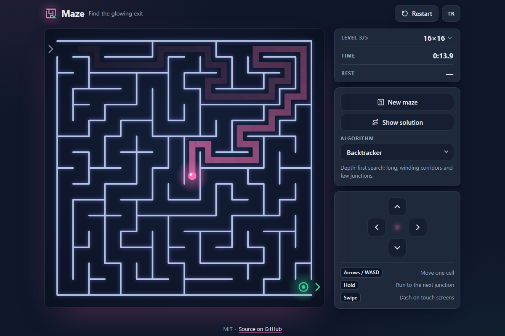

# Maze - find the glowing exit in a fresh perfect maze, right in your browser

[](#tests)
[](LICENSE)

**▶ Play now: https://celaldrg.github.io/maze/**



## Features

- **Three maze generators** you can switch between: recursive backtracker (depth-first search, long winding corridors), randomized Prim (many short dead ends) and Kruskal with union-find (evenly branched). Every maze is *perfect*: exactly one path between any two cells.
- **Five levels**, from 8×8 up to 25×25, with a best time per level saved in your browser.
- **Show solution**: the shortest path (breadth-first search) from where you stand draws itself to the exit. Using it marks the round as *assisted*, so it cannot set a best time.
- **Glowing visuals**: a gliding player dot, a pulsing exit, a fading trail of your last 48 cells and a burst when you solve the maze.
- **Keyboard, swipe and on-screen D-pad**; hold a direction to run along the corridor to the next junction.
- **English and Turkish**, switchable at any time. Language, level and algorithm are remembered.
- Mobile first, sharp on high-DPI screens, respects `prefers-reduced-motion`. No dependencies, no build step, no tracking.

## How to play

Start in the top-left corner and reach the glowing green exit in the bottom-right corner. The timer starts with your first move.

**Keyboard**

| Key | Action |
| --- | --- |
| Arrow keys or W A S D | Move one cell |
| Hold a direction | Run on to the next junction |

**Touch**

- **Swipe** on the board to dash along the corridor until the next junction. Turn in the middle of a swipe to keep going around a corner.
- **D-pad** under the board: tap to step one cell, hold to run.

**Buttons**: *New maze*, *Show solution* / *Hide solution*, *Restart* (same maze from the start), the level and algorithm pickers, and *TR* / *EN* to switch the language.

## Run locally

The game is plain HTML, CSS and JavaScript modules. Serve the folder with any static file server, for example:

```sh
npx serve .
```

Then open the address it prints. Opening `index.html` straight from disk does not work, because browsers only load ES modules over `http://`.

## Tests

The game logic (maze generators, solver, game session, movement, input mapping, storage, settings, translations) lives in pure modules with no DOM access and is covered by [`node:test`](https://nodejs.org/api/test.html) suites. The main proof: every maze from all three generators at all five level sizes (50 seeds each) is connected and has exactly cells − 1 passages, so it is a perfect maze with exactly one path between any two cells. Node 22 or newer:

```sh
node --test
```

With a coverage report:

```sh
node --test --experimental-test-coverage
```

## Project structure

```text
index.html            page markup
style.css             styles, mobile first
src/
  main.js             entry point: wires everything up and runs the animation loop
  renderer.js         canvas drawing: walls, trail, solution, exit, player
  hud.js              stats, buttons, win card and translations in the DOM
  input.js            keyboard, swipe and D-pad events
  game.js             game session: player, timer, trail, hint, best time
  generators.js       backtracker, Prim and Kruskal
  solver.js           breadth-first shortest path
  maze.js, player.js  grid, walls and movement rules
  i18n.js             English and Turkish strings
  storage.js          the only place that touches localStorage
  unionfind.js        disjoint sets for Kruskal
  ...                 rng, levels, records, settings, motion, controls, format, demo
test/                 node:test suites
test-support/         shared test helpers (kept out of test/ so they are not run as tests)
docs/screenshot.png   the picture above (index.html?demo)
```

## License

[MIT](LICENSE) © 2026 Celalettin Durgaç

## Türkçe

Tarayıcıda oynanan, her seferinde yeni ve kusursuz bir labirentte parlayan çıkışı aradığın bir oyun.

**▶ Hemen oyna: https://celaldrg.github.io/maze/**

### Özellikler

- **Üç labirent algoritması**: geri izleme (derinlik öncelikli arama, uzun ve kıvrımlı koridorlar), rastgele Prim (bol sayıda kısa çıkmaz) ve union-find ile Kruskal (dengeli dallanma). Her labirent *kusursuzdur*: iki hücre arasında tam olarak bir yol vardır.
- **Beş seviye**: 8×8'den 25×25'e kadar; her seviyenin en iyi süresi tarayıcında saklanır.
- **Çözümü göster**: bulunduğun yerden çıkışa giden en kısa yol (genişlik öncelikli arama) kendini çizer. Kullanılan turlar *yardımlı* sayılır ve en iyi süre olarak kaydedilmez.
- **Parlayan görünüm**: süzülen oyuncu noktası, nabız gibi atan çıkış, son 48 hücrende solan iz ve labirenti çözünce bir ışık patlaması.
- **Klavye, kaydırma ve ekrandaki yön tuşları**; bir yönü basılı tutunca koridor boyunca sonraki kavşağa koşarsın.
- **İngilizce ve Türkçe**, istediğin an değiştirilebilir. Dil, seviye ve algoritma hatırlanır.
- Önce mobil için tasarlandı, yüksek çözünürlüklü ekranlarda net, `prefers-reduced-motion` ayarına uyar. Bağımlılık, derleme adımı ya da izleme yok.

### Nasıl oynanır

Sol üst köşeden başla ve sağ alt köşedeki parlayan yeşil çıkışa ulaş. Süre ilk hamlende başlar.

- **Klavye**: ok tuşları ya da W A S D ile bir hücre ilerle; yönü basılı tutarsan sonraki kavşağa kadar koşarsın.
- **Dokunmatik ekran**: tahtada kaydırınca koridor boyunca sonraki kavşağa kadar gidersin; kaydırırken yön değiştirip köşeleri dönebilirsin. Tahtanın altındaki yön tuşlarına dokununca bir hücre ilerlersin, basılı tutunca koşarsın.
- **Düğmeler**: *Yeni labirent*, *Çözümü göster* / *Çözümü gizle*, *Yeniden başlat* (aynı labirent baştan), seviye ve algoritma seçicileri, dil için *TR* / *EN*.

### Yerelde çalıştırma

Oyun düz HTML, CSS ve JavaScript modüllerinden oluşur. Klasörü herhangi bir statik dosya sunucusuyla aç:

```sh
npx serve .
```

Sonra yazdırdığı adresi tarayıcıda aç. `index.html` dosyasını doğrudan diskten açmak çalışmaz; tarayıcılar ES modüllerini yalnızca `http://` üzerinden yükler.

### Testler

Oyun mantığı DOM'a dokunmayan saf modüllerdedir ve `node:test` ile test edilir. Ana kanıt: üç üreticinin beş seviye boyutunda ürettiği her labirent (her biri için 50 tohum) bağlantılıdır ve tam olarak hücre − 1 geçidi vardır. Yani labirent mükemmeldir: iki hücre arasında tek bir yol bulunur. Node 22 ya da üstü gerekir:

```sh
node --test
```

Kapsam raporu için: `node --test --experimental-test-coverage`

### Lisans

[MIT](LICENSE) © 2026 Celalettin Durgaç
